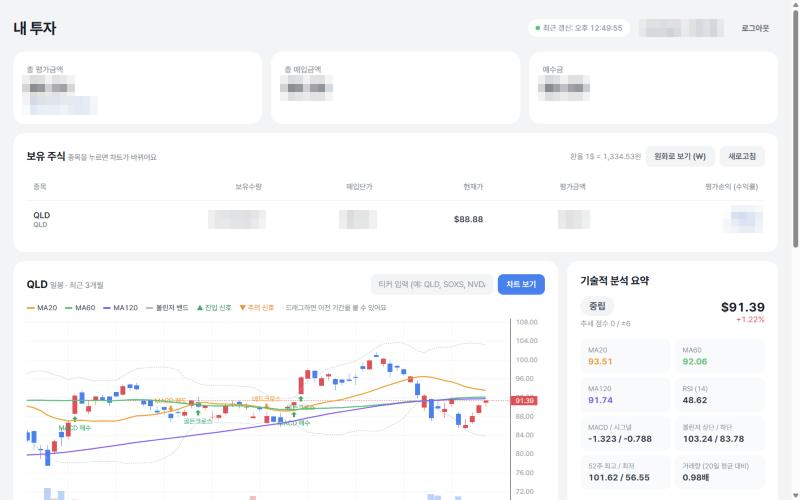
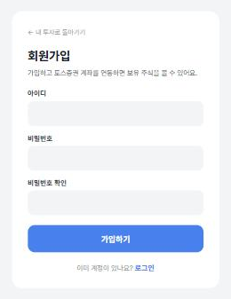
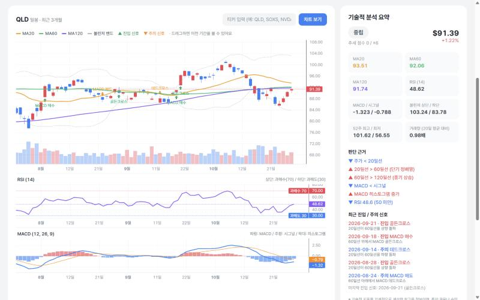
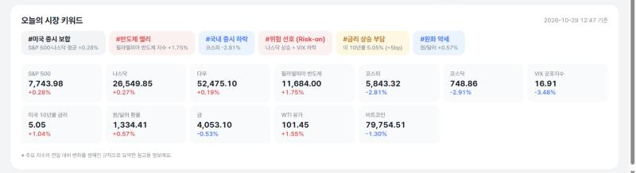

# 📈 내 투자 — 주식 포트폴리오 & 기술적 분석 대시보드

토스증권 OpenAPI와 Yahoo Finance를 연동해 **내 계좌의 보유 주식**, **종목별 일봉 차트와 기술적 지표**, **오늘의 시장 키워드**를 토스 스타일의 한 화면에서 보여주는 웹 대시보드입니다.
회원가입 후 각자 토스증권 API 키를 연동하면 자신의 보유 주식이 표시됩니다.

🔗 **데모 (차트·시장 키워드만)**: https://stock-portfolio-delta.vercel.app



---

## 🚀 주요 기능

### 🔐 회원가입 · 로그인 · 계좌 연동


* 아이디·비밀번호로 회원가입 / 로그인 / 로그아웃
* **계좌 연동** 화면에서 토스증권 Open API의 Client ID · Client Secret · 계좌 ID 입력
  * 저장 전에 실제로 토스 토큰이 발급되는지 확인하고, 실패하면 저장하지 않음
  * 언제든 다른 키로 교체하거나 연동 해제 가능
* 회원마다 자신이 연동한 계좌의 보유 주식만 조회
* 보안
  * 비밀번호는 해시로 저장 (werkzeug)
  * 토스 키는 **암호화**(Fernet)해서 로컬 SQLite에 저장
  * 모든 폼 전송에 CSRF 토큰 검사, 세션 쿠키 `SameSite=Lax`

<br clear="right">

### 💼 보유 주식 실시간 모니터링
* 보유 종목, 보유수량(소수점 주식 지원), 매입단가, 현재가, 평가금액, 평가손익을 **5초마다 자동 갱신**
* 총 평가금액 / 총 매입금액 / 총 평가손익(수익률) 요약 카드
* 수익률은 매입단가와 현재가로 직접 계산해 API 응답 형식과 관계없이 정확하게 표시
* 종목을 누르면 아래 차트가 그 종목으로 바뀜

### 💱 달러 ↔ 원화 전환
* 기본 표시 통화는 **달러(USD)**
* `원화로 보기 (₩)` 버튼으로 실시간 환율(Yahoo Finance `KRW=X`)을 적용한 원화 금액으로 전환

### 📊 일봉 차트 & 기술적 분석


* 상장 이후 전체 일봉을 불러오고 화면에는 **최근 3개월**을 표시 (드래그로 이전 기간 확인)
* 지표: **MA20 / MA60 / MA120**, **볼린저 밴드**(20일, 2σ), **거래량**, **RSI(14)**, **MACD(12, 26, 9)**
* 일봉 · RSI · MACD 세 차트의 스크롤·줌 동기화, 티커 검색으로 아무 종목이나 조회
* 차트 위 **진입(▲) / 주의(▼) 신호**

  | 구분 | 신호 | 조건 |
  |---|---|---|
  | ▲ 진입 | 골든크로스 | 20일선이 60일선을 상향 돌파 |
  | ▲ 진입 | 과매도 탈출 | RSI가 30을 상향 돌파 |
  | ▲ 진입 | MACD 매수 | 60일선 위에서 MACD 골든크로스 |
  | ▼ 주의 | 데드크로스 | 20일선이 60일선을 하향 돌파 |
  | ▼ 주의 | 과열 해소 | RSI가 70을 하향 이탈 |
  | ▼ 주의 | MACD 매도 | 60일선 아래에서 MACD 데드크로스 |

* 오른쪽 **기술적 분석 요약**: 6가지 조건으로 추세 점수(-6 ~ +6)를 매겨 `강한 강세 / 강세 / 중립 / 약세 / 강한 약세` 판정, 판단 근거·경고·최근 신호 표시

### 🗞 오늘의 시장 키워드


* S&P 500, 나스닥, 다우, 필라델피아 반도체, 코스피, 코스닥, VIX, 미국 10년물 금리, 원/달러 환율, 금, WTI 유가, 비트코인의 **전일 대비 변화**
* 정해진 규칙으로 `#미국 증시 강세`, `#반도체 랠리`, `#위험 선호 (Risk-on)`, `#금리 상승 부담`, `#고환율` 같은 **키워드** 생성 (5분 캐시)

> ⚠️ 신호, 강세/약세 판단, 시장 키워드는 지표를 기계적으로 계산한 **참고용 정보**이며 투자 권유나 수익을 보장하지 않습니다.

---

## 🛠 기술 스택
* **Backend**: Python 3, Flask (Blueprint), SQLite, pandas, yfinance, requests, cryptography, python-dotenv
* **Frontend**: Jinja2 템플릿 컴포넌트, CSS, JavaScript ES 모듈, TradingView Lightweight Charts v4.1.1, Pretendard 폰트
* **Data Sources**: 토스증권 OpenAPI (보유 주식), Yahoo Finance (일봉 시세, 환율, 주요 지수)
* **Deploy**: Vercel (Python 런타임)

---

## 🔌 API 엔드포인트

| 엔드포인트 | 설명 |
|---|---|
| `GET /` | 대시보드 화면 |
| `GET·POST /signup`, `/login` · `POST /logout` | 회원가입 · 로그인 · 로그아웃 |
| `GET·POST /account` | 토스증권 계좌 연동 / 해제 |
| `GET /api/holdings` | 로그인한 회원의 보유 종목 및 요약 |
| `GET /api/fx` | 달러/원 환율 (60초 캐시) |
| `GET /api/candles?symbol=QLD` | 일봉, 거래량, 지표, 신호, 분석 요약 |
| `GET /api/market` | 주요 지수 시세 + 시장 키워드 (5분 캐시) |

---

## ⚙️ 실행 방법

### 1. 저장소 클론 및 패키지 설치
```bash
git clone https://github.com/chohyoungjun02/stock_portfolio.git
cd stock_portfolio
python -m venv venv
venv/Scripts/activate        # macOS/Linux: source venv/bin/activate
pip install -r requirements.txt
```

### 2. 서버 구동
```bash
python app.py
```
브라우저에서 `http://127.0.0.1:5000` 접속 → **로그인 → 회원가입 → 계좌 연동** 순서로 진행합니다.

### 3. 참고
* 회원 정보와 암호화된 토스 키는 `instance/app.db`, 암호화 키는 `instance/secret_key`에 저장되며 GitHub·Vercel에 올라가지 않습니다.
  `instance/secret_key`를 지우면 로그인이 풀리고 계좌를 다시 연동해야 합니다.
* Vercel 배포본은 서버에 파일을 저장할 수 없어 **로그인·계좌 연동을 지원하지 않습니다** (차트·시장 키워드만 동작).
* `.env`(`env_example.env` 참고)는 `check.py`, `account.py`를 단독으로 실행해 API 연결을 점검할 때만 필요합니다.

### 4. 테스트
```bash
python tests/test_auth_flow.py        # 회원가입 → 계좌 연동 → 보유 종목 → 로그아웃 흐름
python tests/test_market_keywords.py  # 시장 키워드 규칙
```

---

## 📁 디렉터리 구조
```text
├── app.py                    # Flask 앱 생성, 비밀 키·DB 설정, 블루프린트 등록
├── routes/                   # 화면·API 라우트 (Flask Blueprint)
│   ├── auth.py               #   회원가입·로그인·로그아웃·계좌 연동
│   ├── pages.py              #   GET /  대시보드 화면
│   ├── portfolio.py          #   GET /api/holdings  보유 종목
│   ├── fx.py                 #   GET /api/fx  환율
│   ├── chart.py              #   GET /api/candles  일봉·지표·신호
│   └── market.py             #   GET /api/market  시장 키워드
├── services/                 # 비즈니스 로직
│   ├── users.py              #   회원 DB, 비밀번호 해시, 토스 키 암호화
│   ├── portfolio.py          #   토스 응답 정규화, 손익·수익률 계산
│   ├── fx.py                 #   달러/원 환율 (60초 캐시)
│   ├── indicators.py         #   MA·볼린저·RSI·MACD, 신호, 강세/약세 판단
│   ├── chart.py              #   차트 응답 데이터 생성
│   └── market.py             #   주요 지수 시세, 시장 키워드 규칙
├── templates/
│   ├── index2.html           # 대시보드 레이아웃 (컴포넌트 include)
│   ├── auth_layout.html      # 로그인·회원가입·연동 공통 레이아웃
│   ├── auth.html             # 로그인 / 회원가입
│   ├── link_account.html     # 계좌 연동
│   ├── auth_disabled.html    # 배포본 안내
│   └── components/           # header, summary_cards, holdings_table,
│                             # chart_panel, analysis_panel, market_keywords
├── static/
│   ├── css/                  # base, portfolio, chart, analysis, market, auth
│   └── js/                   # main(진입점), utils, currency, portfolio, chart, analysis, market
├── tests/                    # 회원 흐름·시장 키워드 테스트
├── docs/images/              # README 스크린샷 (금액 모자이크)
├── auth.py                   # 토스증권 토큰 발급 (회원별 메모리 캐시)
├── holding.py                # 보유 주식 조회
├── account.py, check.py      # API 연결 점검용 스크립트
├── requirements.txt          # Python 패키지 목록
├── .vercelignore             # Vercel 업로드 제외 (.env, instance 등)
└── env_example.env           # 환경 변수 예시
```
