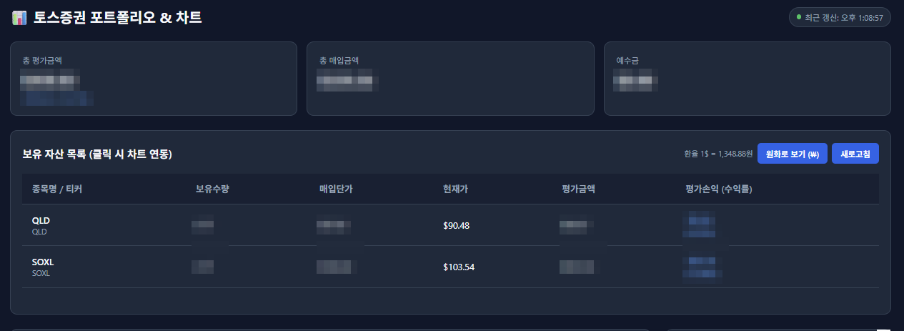
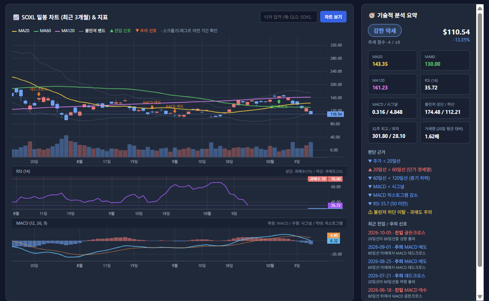

# 📈 주식 포트폴리오 & 기술적 분석 대시보드 (Stock Portfolio Dashboard)

토스증권 OpenAPI와 Yahoo Finance를 연동하여 실시간 보유 자산 현황, 종목별 일봉 차트, 주요 기술적 지표와 강세/약세 판단을 한 화면에서 보여주는 웹 대시보드입니다.





---

## 🚀 주요 기능

### 💼 포트폴리오 실시간 모니터링
* 토스증권 계좌의 보유 종목, 보유수량, 매입단가, 현재가, 평가금액, 평가손익을 **5초 단위 자동 갱신**
* 총 평가금액 / 총 매입금액 / 총 평가손익(수익률) 요약 카드
* 수익률은 매입단가와 현재가로 직접 계산하여 API 응답 형식과 관계없이 정확하게 표시
* 소수점 단위 보유수량(소수점 주식) 지원

### 💱 달러 ↔ 원화 전환
* 기본 표시 통화는 **달러(USD)**
* `원화로 보기 (₩)` 버튼으로 실시간 환율(Yahoo Finance `KRW=X`)을 적용한 원화 금액으로 전환
* 현재 환율 표시 및 1분 주기 자동 갱신

### 📊 일봉 차트 & 기술적 지표
* 상장 이후 전체 일봉 데이터를 불러오고, 화면에는 **최근 3개월**을 기본 표시 (드래그/스크롤로 이전 기간 확인)
* 차트 지표
  * 이동평균선: **MA20 / MA60 / MA120**
  * **볼린저 밴드** (20일, 2σ)
  * **거래량** (상승/하락 색상 구분)
  * **RSI (14)** - 과매수 70 / 과매도 30 기준선
  * **MACD (12, 26, 9)** - MACD, 시그널, 히스토그램
* 일봉 · RSI · MACD 세 차트의 스크롤과 줌이 동기화
* 보유 목록 클릭 또는 티커 검색으로 즉시 차트 전환

### 🧭 진입 시점 & 강세/약세 판단
* 차트 위에 **진입(▲) / 주의(▼) 신호** 마커 표시

  | 구분 | 신호 | 조건 |
  |---|---|---|
  | ▲ 진입 | 골든크로스 | 20일선이 60일선을 상향 돌파 |
  | ▲ 진입 | 과매도 탈출 | RSI가 30을 상향 돌파 |
  | ▲ 진입 | MACD 매수 | 60일선 위에서 MACD 골든크로스 |
  | ▼ 주의 | 데드크로스 | 20일선이 60일선을 하향 돌파 |
  | ▼ 주의 | 과열 해소 | RSI가 70을 하향 이탈 |
  | ▼ 주의 | MACD 매도 | 60일선 아래에서 MACD 데드크로스 |

* 오른쪽 **기술적 분석 요약** 패널
  * 6가지 조건(주가 vs 20일선, 이동평균 정배열, MACD vs 시그널, 히스토그램 방향, RSI 50 기준)으로 **추세 점수(-6 ~ +6)** 산출
  * 점수에 따라 `강한 강세 / 강세 / 중립 / 약세 / 강한 약세` 판정
  * 판단 근거, 과매수·과매도·볼린저 이탈 경고, 최근 신호 목록 표시
  * MA, RSI, MACD, 볼린저 밴드, 52주 최고/최저, 거래량(20일 평균 대비) 요약

> ⚠️ 신호와 강세/약세 판단은 기술적 지표를 기계적으로 계산한 **참고용 정보**이며, 투자 권유나 수익을 보장하지 않습니다.

---

## 🛠 기술 스택
* **Backend**: Python 3.x, Flask, Requests, pandas, yfinance, python-dotenv
* **Frontend**: HTML5/CSS3, JavaScript (Vanilla), TradingView Lightweight Charts (v4.1.1)
* **Data Sources**: 토스증권 OpenAPI (보유자산), Yahoo Finance (일봉 시세, 환율)

---

## 🔌 API 엔드포인트

| 엔드포인트 | 설명 |
|---|---|
| `GET /` | 대시보드 화면 |
| `GET /api/holdings` | 보유 종목 및 요약 (`/api/dashboard-data`와 동일) |
| `GET /api/fx` | 달러/원 환율 (60초 캐시) |
| `GET /api/candles?symbol=QLD` | 일봉 캔들, 거래량, 지표(MA, 볼린저, RSI, MACD), 신호, 분석 요약 |

---

## ⚙️ 실행 방법

### 1. 저장소 클론 및 이동
```bash
git clone https://github.com/chohyoungjun02/stock_portfolio.git
cd stock_portfolio
```

### 2. 가상환경 구성 및 패키지 설치
```bash
python -m venv .venv
source .venv/Scripts/activate  # Windows PowerShell/Bash 기준
pip install flask requests pandas yfinance python-dotenv
```

### 3. 환경 변수 설정 (`.env`)
프로젝트 루트 디렉터리에 `.env` 파일을 생성하고 인증 키를 입력합니다. (`env_example.env` 참고)
```env
TOSS_CLIENT_ID=your_client_id_here
TOSS_CLIENT_SECRET=your_client_secret_here
```
> **주의**: `.env` 파일은 보안상 GitHub에 업로드되지 않으므로 로컬에서 직접 생성해야 합니다.

### 4. 서버 구동
```bash
python app.py
```
브라우저에서 `http://127.0.0.1:5000`으로 접속합니다.

---

## 📁 디렉터리 구조
```text
├── app.py                    # Flask 앱 생성 및 블루프린트 등록
├── routes/                   # API·화면 라우트 (Flask Blueprint)
│   ├── pages.py              #   GET /  대시보드 화면
│   ├── portfolio.py          #   GET /api/holdings  보유 종목
│   ├── fx.py                 #   GET /api/fx  환율
│   └── chart.py              #   GET /api/candles  일봉·지표·신호
├── services/                 # 비즈니스 로직
│   ├── portfolio.py          #   토스 응답 정규화, 손익·수익률 계산
│   ├── fx.py                 #   달러/원 환율 조회 (60초 캐시)
│   ├── indicators.py         #   MA·볼린저·RSI·MACD, 신호 탐지, 강세/약세 판단
│   └── chart.py              #   차트 응답 데이터 생성
├── templates/
│   ├── index2.html           # 페이지 레이아웃 (컴포넌트 include)
│   └── components/
│       ├── header.html
│       ├── summary_cards.html
│       ├── holdings_table.html
│       ├── chart_panel.html
│       └── analysis_panel.html
├── static/
│   ├── css/                  # base / portfolio / chart / analysis
│   └── js/                   # ES 모듈
│       ├── main.js           #   진입점: 컴포넌트 초기화·연결
│       ├── utils.js          #   숫자 변환·포맷
│       ├── currency.js       #   달러 ↔ 원화 전환
│       ├── portfolio.js      #   요약 카드·보유 종목 테이블
│       ├── chart.js          #   일봉·RSI·MACD 차트, 티커 검색
│       └── analysis.js       #   기술적 분석 요약 패널
├── docs/images/              # README 스크린샷
├── auth.py                   # 토스증권 인증 토큰 발급 (메모리 캐시)
├── holding.py                # 계좌 보유 주식 조회
├── account.py                # 계좌 정보 조회
├── check.py                  # API 연결 상태 및 토큰 정상 발급 사전 점검
├── env_example.env           # 환경 변수 예시
├── .gitignore                # Git 제외 설정 (.env, venv 등)
└── README.md                 # 프로젝트 안내 문서
```
